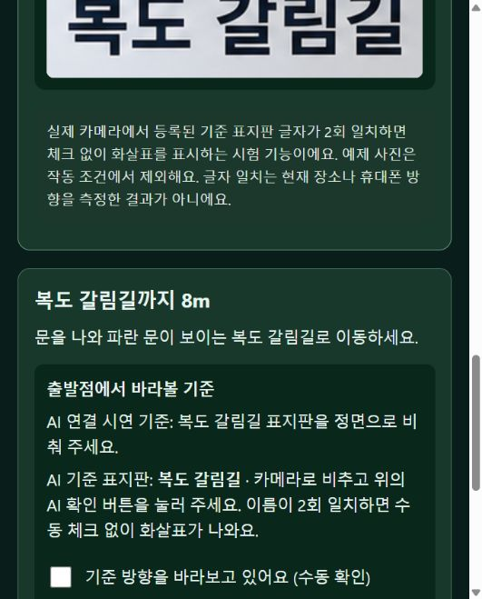

# 작업 현황 — 2026-11-25

## 목표

카메라 화면에 대피 방향을 띄우는 AR 내비게이션. 사진 안내는 보조 기능이며 최종 목표는 실시간 카메라 위 방향 안내입니다.

## 완료

- [x] 건물·층·장소 등록, 수정, 휴지통, 복원
- [x] 장소별 사진 등록과 서버 저장
- [x] 장소 사이 이동 구간·거리·이동 설명 등록
- [x] 같은 건물·층의 비상계단 입구까지 최단 경로 계산
- [x] 통행 불가 구간 제외와 대체 계단 우회
- [x] 관리자 웹을 장소·사진 / 길·통행 / 확인·점검으로 정리
- [x] 큰 글씨 모드, 검색, 큰 버튼
- [x] 등록 정보 점검과 ZIP 백업
- [x] 앱 조회용 API와 별도 읽기 전용 서버
- [x] 브라우저에서 실제 한국어·영어 사진 OCR 실행
- [x] OCR 텍스트에서 건물·층별 장소 후보 제시
- [x] 후보를 사용자가 선택하면 경로 자동 조회
- [x] 각 구간의 다음 장소 사진 보조 안내
- [x] 갤럭시에서 카메라 영상·수동 화살표 작동 사용자 확인
- [x] 로그인 없는 HTTPS 카메라 테스트 페이지 게시
- [x] 계산 경로에 구간별 방향·바라볼 기준을 입력해 안내 파일 내보내기
- [x] 휴대폰에서 안내 파일 가져오기, 구간별 화살표 및 수동 도착 확인
- [x] 구간별 AI 기준 표지판 등록, 두 카메라 프레임 전체 이름 일치 후 화살표 표시 연결 (실기기 추가 확인 필요)
- [x] 표지판 확인 후 방향·거리·이동 설명 한국어 음성 안내
- [x] 새 이동 방향 준비 시 진동 안내 및 음성 다시 듣기
- [x] 큰 글씨·고대비·음성·진동 설정을 휴대폰에 저장

## 확인한 결과

| 확인 항목 | 결과 |
| --- | --- |
| 기존 서버 테스트 | 34개 통과 |
| 최신 웹 빌드 | 통과 |
| 가상 회사 기본 경로 | 방 → 복도 갈림길 → 동쪽 계단, 20m |
| 기존 우회 검증 | 동쪽 연결 차단 시 서쪽 계단 60m, 해제 시 20m 복귀 |
| OCR 결과 | 예제 표지판에서 '듣기' 인식, 'ai' 오인식. 전체 이름 일치 성공으로 판단하지 않음 |
| 후보 선택 → 경로 | 일부 일치 후보를 직접 선택한 뒤 20m 경로 표시 |
| 건물·층 변경 | 기존 경로 제거, 새 후보 선택 필요 |
| 계단 미등록 장소 | 계단 미등록 안내, 다른 건물 경로가 남지 않음 |
| 사진 보조 안내 | 서버 사진 로딩과 복도 사진 표시 확인 |
| 카메라·수동 화살표 | 갤럭시에서 사용자 작동 확인 |
| 경로 파일·AI 판정 | 자동 테스트 12개 통과 |
| 음성·진동 안내 | 웹 빌드 통과. 갤럭시의 실제 음성·진동은 추가 확인 필요 |
| 공개 AI 실행 | 예제 '복도 갈림길' 인식 확인. PC에서 모델 준비 포함 9.6초, 갤럭시 수치 아님 |
| 예제의 잘못된 자동 표시 차단 | OCR 일치해도 예제 이미지는 화살표를 켜지 않고 도착 버튼 비활성 유지 |

같은 예제 사진으로 한 확인이며 일반적인 인식률·실제 대피 안전성 검증은 아닙니다.

## 다음 작업

- [ ] 친구 프로젝트 파일 수령, 기술과 구현 상태 확인
- [ ] 서로 겹치는 관리자 기능 정리 및 API 연결
- [x] 사용자 화면에 실시간 카메라 영상 표시
- [x] 카메라 화면 위 이동 방향 화살표 표시
- [ ] 화면 고정 화살표와 공간에 고정되는 AR 안내의 구현 범위 결정
- [ ] 등록 경로와 휴대폰 위치·바라보는 방향의 기준 맞추기
- [ ] 실제 표지판 사진으로 OCR 비교 테스트
- [ ] 갤럭시에서 실제 표지판 두 프레임 인식→화살표 표시 전체 흐름 검증
- [ ] 안내 파일 대신 경로 서버와 실시간 연결
- [ ] 최종 시연 동선과 발표 영상 준비

## 미구현·제약

실시간 카메라와 화면 위 화살표는 구현했습니다. 자동 위치·진행 방향 판별이나 바닥에 고정되는 공간 AR은 구현하지 않았습니다. 공개 페이지는 현재 경로 파일을 가져오는 방식이며 PC 서버의 통행 변경을 실시간 수신하지 않습니다. 최신 경로는 다시 계산·저장해서 가져와야 합니다. 기본 경로의 도착점은 같은 층의 계단 입구입니다. 개인 PC의 실제 DB·백업·가상환경·설치 패키지는 공유하지 않습니다.

경로 파일·AI 판정 테스트 12개 및 웹 빌드 통과. 공개 페이지에서 예제의 직진→오른쪽 전환 확인. 가상 회사 예제의 방향은 시연용 지정값으로 실제 공간에서 따를 수 없습니다. [카메라 안내 상세](../admin-web/CAMERA-테스트.md)

공개 테스트: https://ar-evacuate-camera-test.workspace-815047.chatgpt.site/

